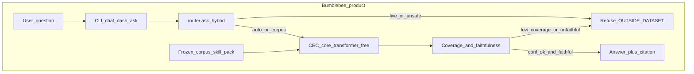
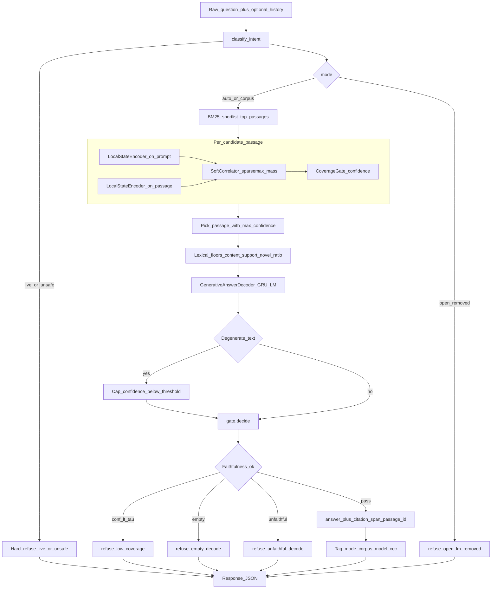
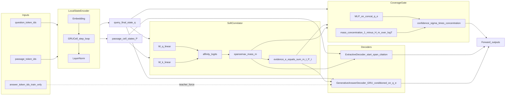
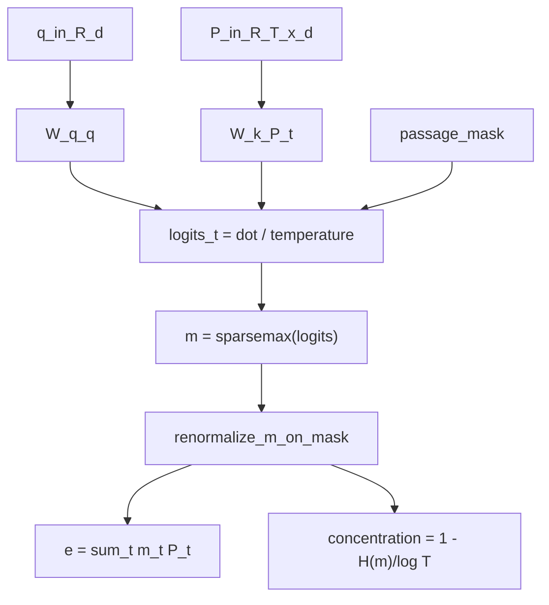
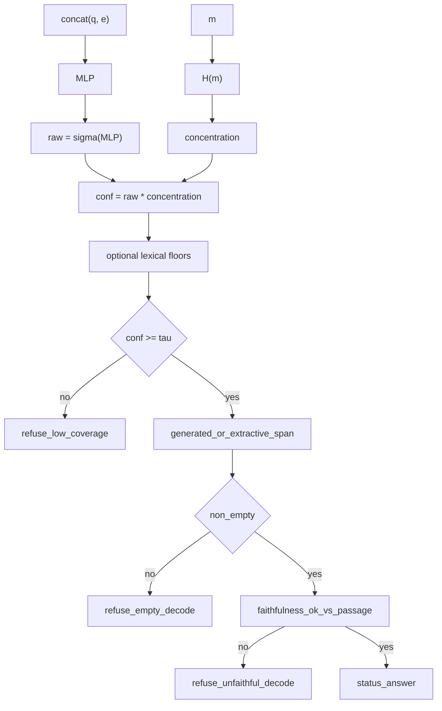
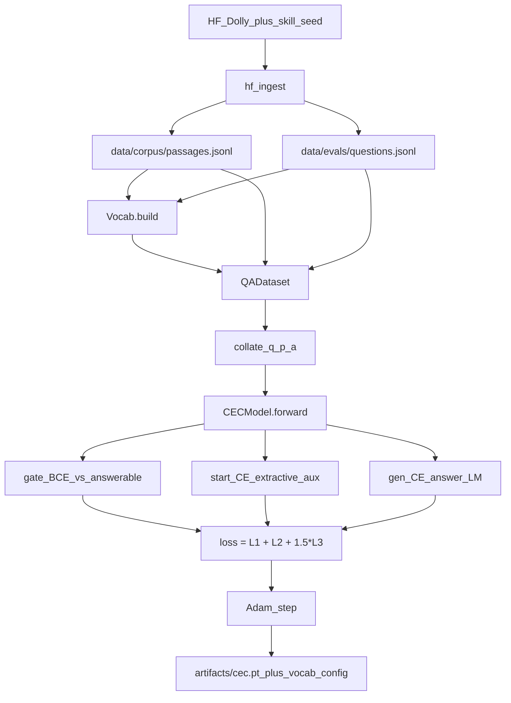
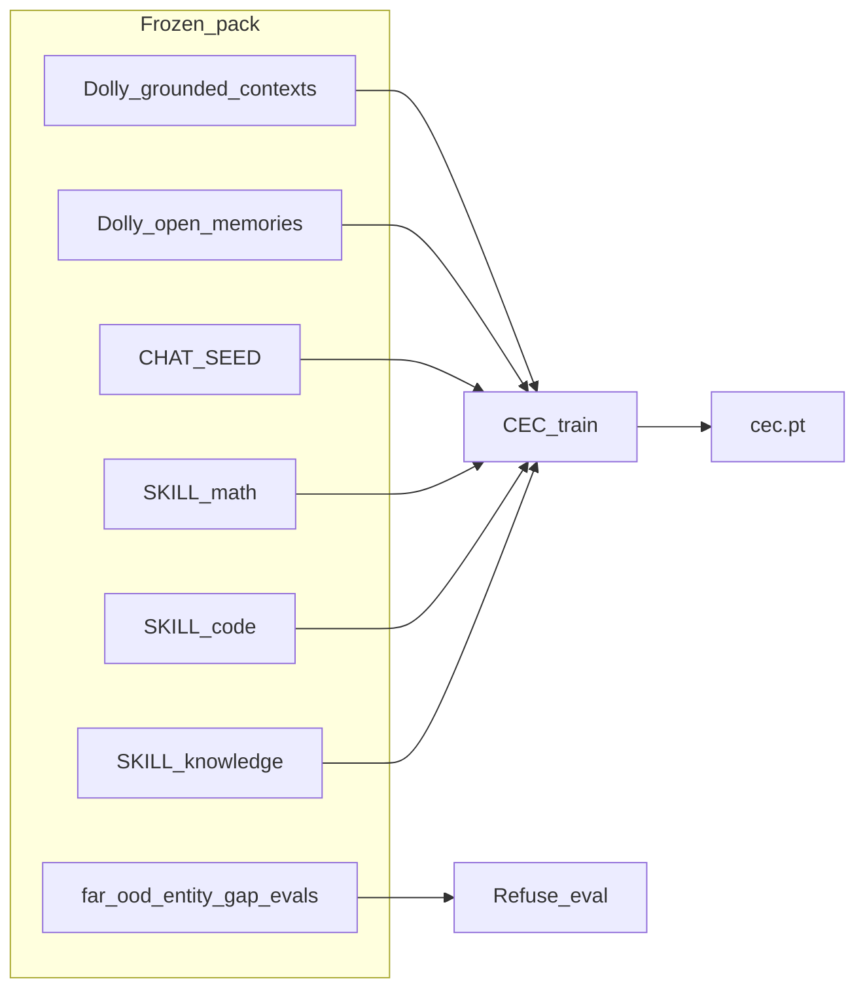
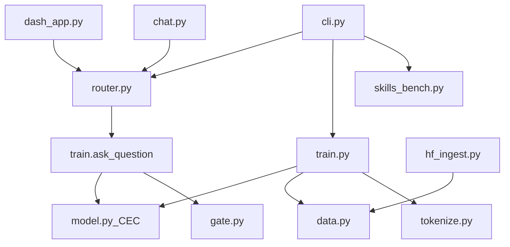
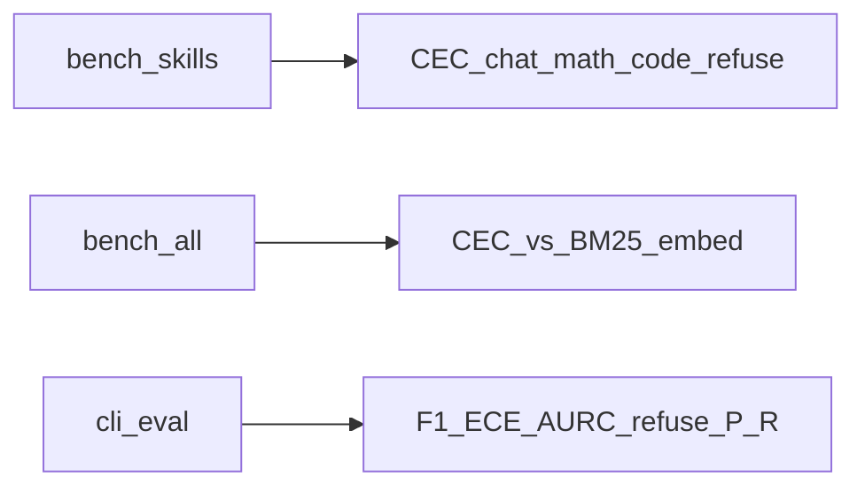

# Bumblebee CEC — Full Architecture Flowcharts

Complete system maps for training, inference, routing, and module ownership.  
Companion to [ARCHITECTURE.md](ARCHITECTURE.md). Patent posture: [PATENT_LETTER.md](PATENT_LETTER.md) (**nothing filed**).

---

## 1. System context (what Bumblebee is)

**Product path:** User → Router → **CEC only**. Open-LM sidecar removed.

---

## 2. End-to-end inference (full detail)

---

## 3. CEC neural stack (forward pass)

---

## 4. SoftCorrelator math (control flow)

No full-sequence \(QK^\top\) attention over tokens. Mass is over **passage cells** only.

---

## 5. CoverageGate + decide (refusal logic)

---

## 6. Training pipeline

Skill categories ingested into the same pack: **chat, math, code, knowledge** (+ Dolly grounded/open memories).

---

## 7. Data / skill pack composition

---

## 8. Module map (code ownership)

| File | Responsibility |
| --- | --- |
| `model.py` | LocalStateEncoder, SoftCorrelator, CoverageGate, ExtractiveDecoder, GenerativeAnswerDecoder, CECModel |
| `gate.py` | `decide`, faithfulness, token F1 |
| `train.py` | train loop, `ask_question`, corpus eval |
| `router.py` | intent + CEC-only product entry |
| `hf_ingest.py` | Dolly + skill seeds → JSONL (optional `[ingest]`) |
| `skills_bench.py` | chat/math/code/corpus/refuse suite |

---

## 9. Benchmark surface

---

## Reading order

1. This file — full control flow  
2. [ARCHITECTURE.md](ARCHITECTURE.md) — equations + claims  
3. [PRIOR_ART.md](PRIOR_ART.md) — known families  
4. [PATENT_LETTER.md](PATENT_LETTER.md) — invention disclosure draft (**not a granted patent**)
