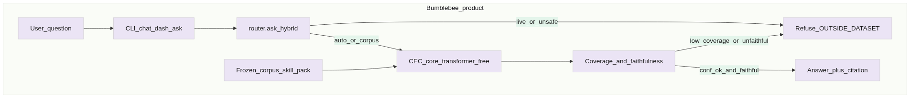
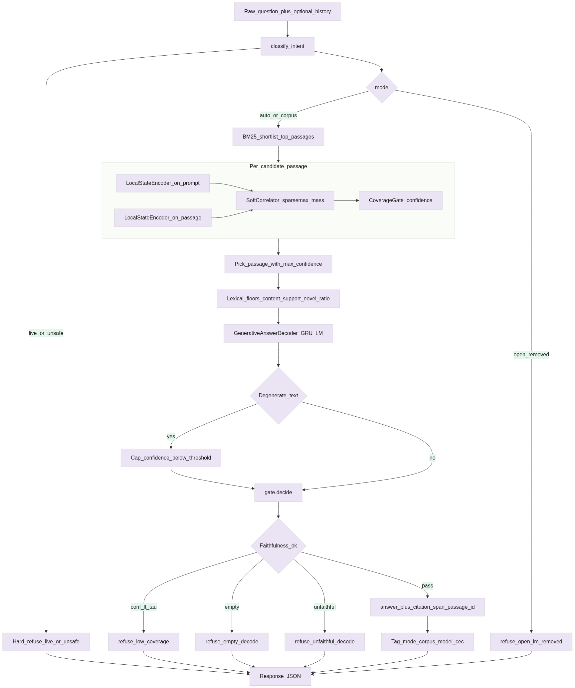
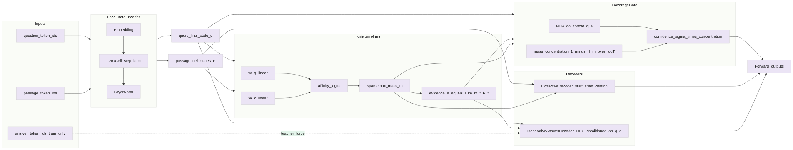
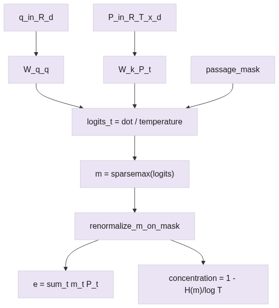
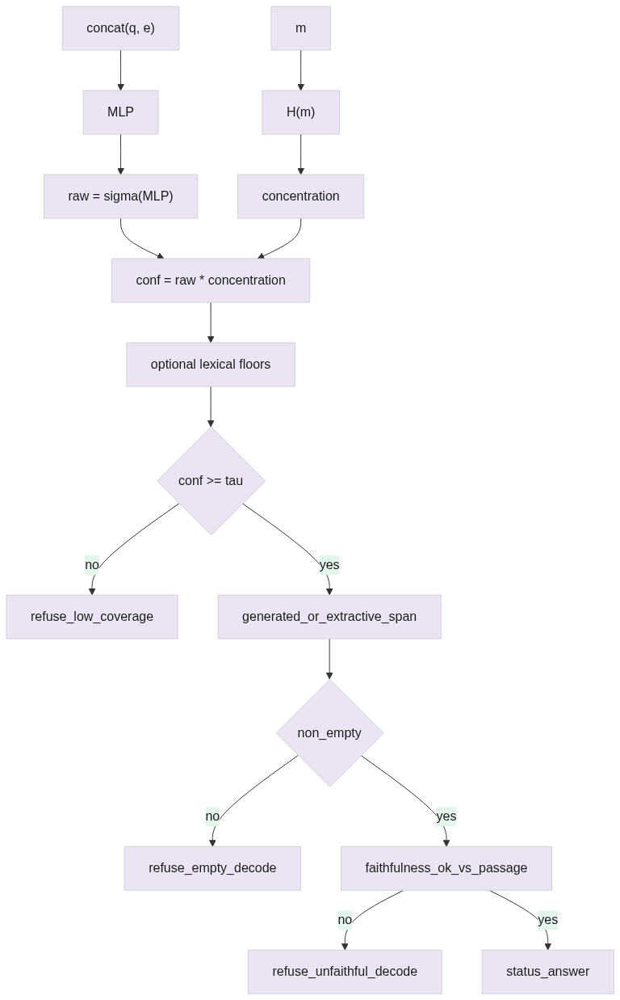
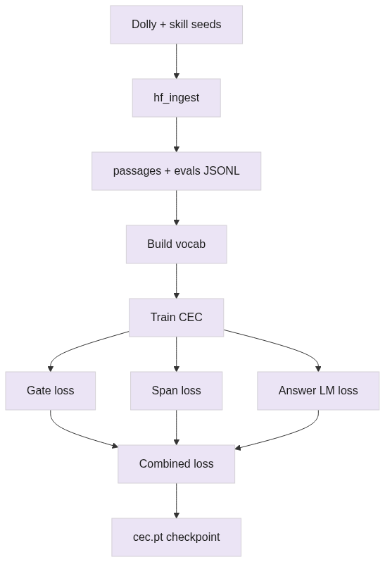
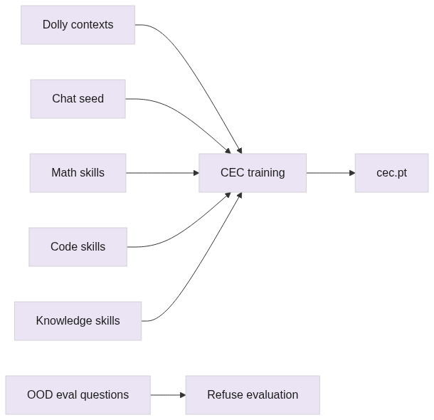
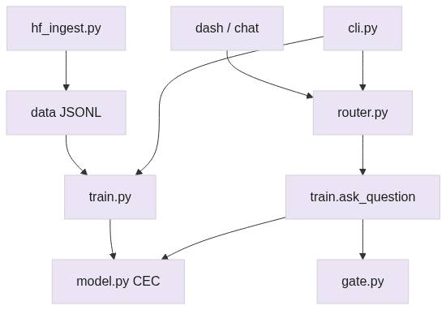
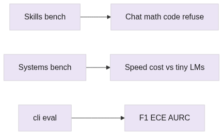

# How Bumblebee Works

PNG diagrams: [`architecture_pngs/`](architecture_pngs/) · Re-render: `python scripts/render_architecture_pngs.py`

---

## Elevator paragraph (use this)

**Bumblebee** is a small, self-contained question-answering system built around **CEC (Correlated Evidence Cells)** — an alternative to the usual “transformer” chatbot design. Instead of letting a giant model freely invent the next word from the whole internet, Bumblebee keeps a **frozen knowledge pack** (docs, chat, math, and coding examples it was trained on), turns the user’s question and those passages into sequences of internal states with a simple recurrent network (a GRU — think of it as reading left-to-right and updating a memory cell), then a **SoftCorrelator** assigns sparse weights to the passage pieces that look relevant and builds an **evidence** summary from them. A **CoverageGate** scores how concentrated that evidence is: if it’s strong and the generated answer still matches the passage (**faithfulness**), Bumblebee returns the answer **with a citation**; if the question is outside the pack, live/unsafe, or the evidence is weak, it **refuses** rather than hallucinating. So in one line: *retrieve and bind evidence without transformer attention, answer only when coverage is good, otherwise say no.*

---

## What runs where

| Stage | Task |
| --- | --- |
| Router | Block live/unsafe; packs and tools first; otherwise CEC |
| Frozen pack | Store what CEC is allowed to know |
| BM25 | Shortlist candidate passages |
| LocalStateEncoder | Read tokens into cell states (GRU) |
| SoftCorrelator | Weight which cells matter → evidence |
| CoverageGate | Confidence from evidence concentration |
| Answer decoder | Write the reply from evidence |
| gate.decide | Answer + cite, or refuse |
| Open LM | Removed. `mode=open` hard-refuses (`open_lm_removed`). |

---

## Diagrams

### 1. System context

### 2. Inference end-to-end

### 3. CEC neural stack

### 4. SoftCorrelator

### 5. CoverageGate + decide

### 6. Training

### 7. Skill pack

### 8. Code modules

### 9. Benchmarks

Editable mermaid: [ARCHITECTURE_FLOWCHART.md](ARCHITECTURE_FLOWCHART.md) · sources in `architecture_pngs/mmd/`.
